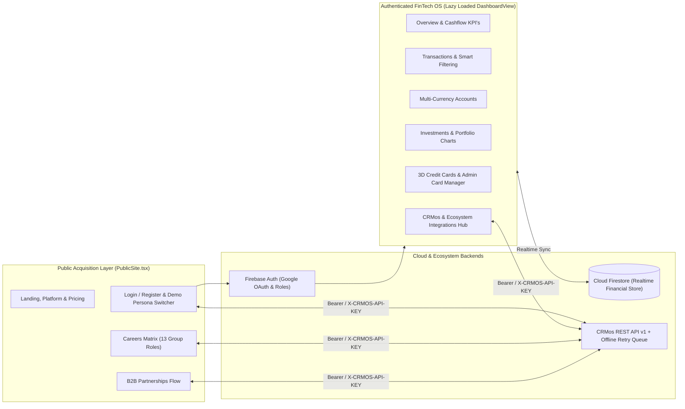

# Xabi World — Next-Gen Wealth Management, 3D Card Studio & Executive Financial OS

[](https://www.typescriptlang.org/)
[](https://react.dev/)
[](https://vitejs.dev/)
[](https://firebase.google.com/)
[](https://tailwindcss.com/)
[](https://xabi-world.vercel.app)

> **Executive Summary (NL):** **Xabi World** (`xabi.world`) is een high-end financieel besturingssysteem en wealth-management platform dat particulier bankieren, zakelijk treasury-beheer, portefeuille-analyse, interactief 3D-betaalkaartbeheer en een bidirectionele **CRMos REST API v1** integratie samenbrengt. Geoptimaliseerd voor snelheid (84% kleinere initiële bundle via route-level code-splitting) en voorzien van rolgebaseerde Firebase Authentication & Cloud Firestore synchronisatie.
>
> **Executive Summary (EN):** **Xabi World** (`xabi.world`) is an executive FinTech & Wealth Management platform built with React 19, TypeScript, Firebase (Google OAuth + Firestore), and Chart.js/Recharts. It features multi-tier personas (Retail, Premium Investor, Corporate, Admin), interactive 3D hardware/metal card visualizers, offline-resilient **CRMos REST API v1** synchronization, and an 84% reduction in initial bundle payload through aggressive lazy loading.

---

## Waarom dit project technisch onderscheidend is (For Technical Recruiters & CTOs)

**Xabi World** laat zien hoe een veeleisende FinTech-gebruikerservaring wordt gecombineerd met robuuste cloud-persistentie en enterprise-integraties:

1. **Performance Engineering — 84% Reductie van Initial Bundle Size**:
   - Strikte scheiding tussen de publieke marketing-/acquisitiepagina's (`PublicSite.tsx`) en de zware financiële analyse-omgeving (`DashboardView.tsx`) via `React.lazy` en `Suspense`.
   - Geëlimineerde render-loops in 3D-canvas en scroll-animaties (`MotionCanvas3D.tsx`, `Card3DTilt.tsx`), geoptimaliseerde font-preconnects en directe First Contentful Paint (FCP).
2. **Realtime Financiële State & Multi-Persona RBAC (`financial-store.tsx`, `auth-context.tsx`)**:
   - Volledige **Firebase Authentication** (Google OAuth + e-mail/wachtwoord) en **Cloud Firestore** persistentie met automatische roltoewijzing (`Admin` rechten voor directie-accounts `info@xabi.world` & `info@jamaldrenthe.com`).
   - Ondersteunt directe persona-switching voor live productdemonstraties:
     - **Daan Vermeulen** (*Particulier / Basis Lid*)
     - **Sophie van Dijk** (*Premium Belegger*)
     - **Lucas de Boer** (*Zakelijk Ondernemer*)
3. **Interactieve 3D Betaalkaart-Architectuur (`BankCardVisual.tsx`, `Card3DTilt.tsx`, `AdminCardManager.tsx`)**:
   - Fysiek-geïnspireerde 3D-tilt credit- en debitcards met EMV-chip details, dynamische bestedingslimieten, pincode-/bevriezingsacties en een **Admin Card Manager** voor het uitgeven en beheren van kaarten over gebruikers heen.
4. **Offline-Resilient Bidirectionele CRMos v1 Integratie (`src/lib/crmos.ts`)**:
   - Synchroniseert nieuwe registraties, zakelijke partnerships, kredietaanvragen en sollicitaties (13 groepsposities op de vernieuwde Careers-pagina) realtime met **CRMos (`crmos.one/api/v1`)**.
   - Bevat een automatische **Offline Sync Queue (`localStorage`)** die gefaalde netwerkverzoeken buffert en hervat zodra de verbinding is hersteld.

---

## Systeemarchitectuur



---

## Kernmodules & Functionaliteiten

### 1. Executive Dashboard & Rekeningenbeheer (`Overview.tsx`, `Accounts.tsx`)
- **Geconsolideerd Vermogensoverzicht**: Direct inzicht in totaal vermogen, maandelijkse inkomsten vs. uitgaven, spaardoelen en actieve rekeningen (Betaal-, Spaar-, Beleggings- en Zakelijke Treasury-rekeningen).
- **Snel-overschrijven & Balansmutaties**: Voer realtime overboekingen uit die direct doorwerken in de grafieken en transactiehistorie.

### 2. Geavanceerd Transactie- & Cashflowbeheer (`Transactions.tsx`)
- **Multi-dimensionale Filters**: Filter transacties op categorie, rekeningtype, inkomsten/uitgaven, status (`Voltooid`, `In behandeling`) en vrije zoektermen.
- **CSV/Rapportage Export & Categorisatie**: Inzicht in terugkerende abonnementen en zakelijke kostenposten.

### 3. Beleggingsportefeuille & Rendementsanalyse (`Investments.tsx`)
- **Interactieve Datavisualisatie**: Gecombineerde **Chart.js (`react-chartjs-2`)** en **Recharts** grafieken voor meerjarige portefeuillegroei, maandelijkse dividend-/omzetontwikkeling en asset-allocatie (Aandelen, ETF's, Vastgoedfondsen, Crypto & Liquide middelen).

### 4. 3D Creditcard Studio & Admin Card Control (`CreditCards.tsx`, `AdminCardManager.tsx`)
- **Interactieve 3D Kaartweergave**: Realistische perspectief-tilt, kaartnummer-maskering, contactloos betalen toggles, daglimiet-sliders en kaartblokkering met directe toast-bevestiging.
- **Admin Kaartbeheer**: Beheerders kunnen voor specifieke gebruikers binnen het netwerk kaarten uitgeven, limieten aanpassen en statussen wijzigen in Firestore.

### 5. Ecosysteem Integraties & Strategische Vacaturebank (`Integrations.tsx`, `PublicSite.tsx`)
- **CRMos Sync Cockpit**: Bekijk en beheer de live verbinding met `crmos.one`, test webhooks en synchroniseer de lokale wachtrij.
- **Careers & Partnerships Portal**: Overzichtsmatrix met 13 strategische functies binnen de holding, transparante remote-arbeidsvoorwaarden en een directe sollicitatiepijplijn naar CRMos.
- **Meertaligheid (NL / EN)**: Volledig ondersteunde taalwisseling via `language-context.ts` en schakelbaar Dark/Light thema.

---

## Tech Stack

| Categorie | Technologieën |
| :--- | :--- |
| **Frontend Core** | React 19.2, TypeScript 5.9, Vite 7.2 |
| **Datavisualisatie & 3D** | Chart.js 4.5, `react-chartjs-2`, Recharts 2.15, Custom 3D CSS/Canvas Tilt & Film Reel animaties |
| **UI & Componenten** | Tailwind CSS 3.4, Radix UI Primitives, shadcn/ui, Lucide React, Sonner, Canvas Confetti |
| **Formulieren & Validatie** | React Hook Form 7.70, Zod 4.3 |
| **Backend & Persistentie** | Firebase Authentication (Google OAuth), Cloud Firestore (`firestore.rules` & `firestore.indexes.json`) |
| **Externe API's** | Bidirectionele CRMos REST API v1 Client (`src/lib/crmos.ts`) met Offline Queue |

---

## Projectstructuur

```text
Xabi-World/
├── src/
│   ├── components/
│   │   ├── PublicSite.tsx          # Publieke pagina's (Home, Platform, Pricing, Partnerships, Careers, Contact)
│   │   ├── DashboardView.tsx       # Lazy-loaded geauthenticeerde FinTech werkomgeving
│   │   ├── BankCardVisual.tsx      # 3D betaalkaart-renderer met chip & merk-styling
│   │   ├── Card3DTilt.tsx          # Interactieve muis-gebaseerde 3D-perspectief container
│   │   ├── AdminCardManager.tsx    # Admin-paneel voor multi-user kaartbeheer
│   │   ├── CinematicFilmReel.tsx   # Partner-ecosysteem carrousel (12+ holdings)
│   │   └── ui/                     # Herbruikbare Radix UI / shadcn primitieven
│   ├── sections/
│   │   ├── Overview.tsx            # Hoofddashboard met saldo's, kaarten en grafieken
│   │   ├── Transactions.tsx        # Transactietabel, zoekfilters en mutaties
│   │   ├── Accounts.tsx            # Rekeningenoverzicht en geldtransfers
│   │   ├── Investments.tsx         # Vermogensgroei, ROI-metrics en allocatie
│   │   ├── CreditCards.tsx         # Kaartinstellingen, limieten en uitgavenanalyse
│   │   ├── Integrations.tsx        # Live CRMos REST API v1 status & synchronisatiebeheer
│   │   └── Settings.tsx            # Profiel-, beveiligings- en voorkeursinstellingen
│   ├── lib/
│   │   ├── auth-context.tsx        # Firebase Auth provider, RBAC & Demo Persona switcher
│   │   ├── financial-store.tsx     # Realtime Firestore synchronisatie voor rekeningen & transacties
│   │   ├── crmos.ts                # Bidirectionele CRMos v1 API client + offline retry queue
│   │   ├── firebase.ts             # Firebase SDK initialisatie
│   │   └── language.tsx            # Tweetalige (NL/EN) vertaalcontext
│   └── App.tsx                     # Router, code-splitting en thema-orkestratie
├── firestore.rules                 # Beveiligingsregels voor gebruikers- en admin-documenten
├── firestore.indexes.json          # Samengestelde Firestore-indexen
└── vercel.json                     # Productie routing & security headers
```

---

## Lokaal Ontwikkelen & Uitvoeren

### Vereisten
- **Node.js** v20+ en `npm`

### Installatie & Starten
```bash
git clone https://github.com/JamalDrenthe/Xabi-World.git
cd Xabi-World
npm install
npm run dev
```
Open `http://localhost:5173` in je browser. Op de inlogpagina kun je inloggen via **Google OAuth** of met één klik een van de drie voorgeconfigureerde **Demo Persona's** (*Particulier*, *Premium Belegger*, *Zakelijk*) starten.

### Beschikbare Scripts
| Script | Beschrijving |
| :--- | :--- |
| `npm run dev` | Start de Vite 7 ontwikkelserver met HMR. |
| `npm run build` | Voert een strikte TypeScript-build (`tsc -b`) uit en genereert de productiebundel. |
| `npm run lint` | Controleert de codekwaliteit met ESLint 9. |
| `npm run preview` | Serveert de productiebuild lokaal. |

---

## Over de Architect & Samenwerking

Ontworpen en gebouwd door **Jamal Drenthe** — Full-Stack Software Engineer, FinTech Systems Architect & Founder van **Quantum Initium**.

Zoek je als **recruiter**, **engineering manager** of **zakelijke partner** een specialist die financiële interfaces, realtime cloud-backends en enterprise API-koppelingen op topniveau neerzet?

- **GitHub**: [@JamalDrenthe](https://github.com/JamalDrenthe)
- **E-mail**: [info@jamaldrenthe.com](mailto:info@jamaldrenthe.com)
- **Live Applicatie**: [xabi.world](https://xabi.world) / [xabi-world.vercel.app](https://xabi-world.vercel.app)
